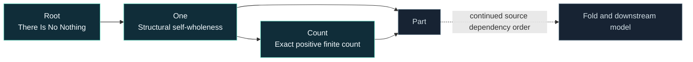

<p align="center">
  
</p>

<p align="center">
  <a href="#the-model">The model</a> ·
  <a href="#proof-status">Proof status</a> ·
  <a href="ZENODO_PAPER_DRAFT.txt">Read the paper</a> ·
  <a href="#run-the-proofs">Run the proofs</a> ·
  <a href="TIMELINE.txt">Timeline</a>
</p>

<p align="center">
  
  
  
  
</p>

# One model. Every derivation. Machine-checked.

**SFT v4 is the native Lean formalisation of Maria Smith’s Smithian Fold Theory v3.** The task is exact: carry the existing model into Lean, preserving its definitions, constraints, dependency order and derivations across all **2,781 registered entries**.

The governing requirement is **1:1 correspondence with v3**. Each scientific declaration is tied to its source. Each completed proof is audited for axiom dependencies. The entire model is the verification target.

## The model

SFT presents a structural unified theory of everything: gravity, particles and physical constants derived from first principles, with zero added axioms and zero free scientific parameters. This repository is the formal verification programme for that existing model.

Its foundation begins with an operational distinction: absence presents no counterexample; a presented challenge supplies an occurrence. The source then develops structural One and exact positive finite count, followed by Part, Fold and the downstream model.



## Proof status

**1,400 proofs completed · 4,966 candidate records matched · 20 model entries underway.**

| Progress measure | Current result |
| :--- | :--- |
| Lean theorems proved | **1,400**, all with zero axiom dependencies |
| Definitions and theorems audited | **2,505**, all with zero axiom dependencies |
| Candidate records matched to v3 | **4,966 / 4,966** across Root, One, Count, Part, Part Equivalence, Fold, Fold Assembly, Exact Operations, Half-One, Fold Dynamics, Form Grammar, Form Enforcement, Measured Value Boundary, Exact Arithmetic Discrete Objects and Primitive Map Uniqueness |
| Complete model entries | **0 / 2,781**; full-entry verification remains in progress |

| Source component | Verified work | Evidence |
| :--- | :--- | :--- |
| **Root** | Complete two-class enumeration, unique survivor, survivor acceptance, presentation-only decision, witness deletion within the partition, three control outcomes; explicit tampered survivor set and non-uniqueness proofs | [Lean source](SFT/Foundation/Root.lean) |
| **One** | Complete six-class enumeration, unique survivor and survivor acceptance | [Lean source](SFT/Foundation/One.lean) |
| **Count** | Complete ten-class enumeration, unique survivor and survivor acceptance | [Lean source](SFT/Foundation/Count.lean) |
| **Part** | 192-form enumeration, exact seven-criterion acceptance, minimality rejections and finite held/whole coordinate construction | [Part proofs](SFT/Foundation/Part.lean) · [Selection proofs](SFT/Foundation/PartSelection.lean) |
| **Common refinement** | Generated pair cells, complete index pairing, identity/reversal/composition and uniform-refinement preservation | [Derivation](SFT/Foundation/CommonRefinement.lean) |
| **Fold** | 288-form grammar and exact criteria; acceptance tied to unique minimal Count stage; two distinct retained positions | [Derivation](SFT/Foundation/FoldDerivation.lean) |
| **Fold assembly** | 192-form grammar; full finite stage, transition and return traces; canonical witness realised with complete unique support | [Assembly derivation](SFT/Foundation/FoldAssembly.lean) |
| **Exact operations** | Canonical Fraction reduction, exact value preservation, positive-domain guards, normalized cast/Fold/Take, exact unison and Fold-fixed One; complete 128-form grammar and source controls | [Operations](SFT/Foundation/ExactOperations.lean) · [Reduction proofs](SFT/Foundation/FractionReduction.lean) |
| **Half-One** | Complete first-Fold selection classes, label-exchange invariance, unique self-junction coordinate, self-complementarity and Fold-to-One; all 128 source candidates and four controls | [Derivation](SFT/Foundation/HalfOneDerivation.lean) |
| **Fold dynamics** | Exactly two preimages for every admitted image, with arbitrary-preimage exhaustion; full-domain phase laws, exact sorted output and executable uniformity for every even division and minimal two-cycle | [Derivation](SFT/Foundation/FoldDynamics.lean) |
| **Form Grammar** | Complete 288-candidate enumeration, unique survivor, nine rejection rules and original controls | [Grammar](SFT/Foundation/FormGrammar.lean) |
| **Exact trace arithmetic** | General flattened-product associativity, complete pair-cell cardinality, exact pairing and held remainder | [Derivation](SFT/Mathematics/ExactTraceArithmetic.lean) |
| **Measured-value boundary** | Exact Boolean protocol conditions, complete 256-candidate product and original controls | [Derivation](SFT/Foundation/MeasurementProtocol.lean) |
| **Form identity** | Canonical trace injectivity and equivalence for every generated Form; complete 192-candidate identity grammar | [Derivation](SFT/Foundation/FormIdentity.lean) |
| **Form construction** | Exact finite productions, injective tuple encoding and acceptance of every generated form by the tuple/string validator | [Derivation](SFT/Foundation/FormConstruction.lean) |
| **Source correspondence** | All 4,966 candidate records preserve source order, identifiers, exact forms, decisions and reasons; Root census, closure, decisions and all four control records match stored fields and hashes | [Correspondence map](reference/CORRESPONDENCE.json) · [Parity report](verification/TURN_097_PARITY_REPORT.json) |

**Full-model completion: 0 / 2,781 entries.** Twenty entries are in progress; 2,761 remain pending. The results above certify the translated portions. Remaining Root work includes general implementation-correspondence proofs, full operational semantics and admission integration. Full-entry completion is tracked separately from finite classification proofs.

[Read the current axiom audit →](verification/TURN_097_BUILD.log) · [Inspect complete coverage →](COVERAGE.json) · [Root evidence/hash checks →](verification/TURN_013_EVIDENCE_REPORT.json) · [All 2,505 axiom audits →](verification/TURN_097_ALL_DECLARATIONS_AUDIT.log)

The translated forcing gate checks ordered identifiers, exactly one survivor, explicit reasons and canonical proof-hash identities. A general theorem proves that passing requires one survivor; Root’s tampered decisions are formally rejected. [Gate proofs](SFT/Engine/DecisionGate.lean) · [Root integration](SFT/Foundation/RootGate.lean) · [384-case comparison](verification/TURN_009_DECISION_GATE_REPORT.json)

The closure and control gates now retain their source field checks and error order. Native proofs establish required passing properties and reject Root evidence with missing minimality, missing generality certification or failed control flags. [Evidence-gate proofs](SFT/Engine/EvidenceGates.lean) · [432 closure and 576 control cases](verification/TURN_010_EVIDENCE_GATES_REPORT.json)

The census gate preserves signed cardinalities, candidate identity checks and source error order. Native proofs establish positive-cardinality witnesses and reject Root censuses with incorrect counts or duplicate candidates. [Census gate](SFT/Engine/CensusGate.lean) · [1,440-case comparison](verification/TURN_011_CENSUS_GATE_REPORT.json)

The Root record-level derivation now quantifies over all records with the source fields. It proves exact presentation classification, agreement of classification and acceptance, exclusion of unpresented records, and independence from identifier and descriptive text. Generated records connect directly to the emitted evidence. [Root derivation proofs](SFT/Foundation/RootDerivation.lean)

One’s record-level derivation proves that complete coverage without addition is necessary and sufficient for acceptance. Omission, fragmentation and unforced addition are rejected for every source-schema record. [One derivation proofs](SFT/Foundation/OneDerivation.lean)

Count’s finite-generation proof now establishes complete exact-once retention at every extension, freshness of the new terminal, rejection of repetition and deletion, and unique identity under the source base/successor clauses. [Count trace derivation](SFT/Foundation/CountTrace.lean)

Count’s proposal theorem derives the ten-class decision from actual retained positions: acceptance is equivalent to complete coverage, no duplication and no ungenerated occurrence. [Semantic bridge](SFT/Foundation/CountRepresentation.lean) · [493-proposal correspondence](verification/TURN_016_COUNT_REPRESENTATION_REPORT.json)

## Exact correspondence, from the root

| Commitment | How it is recorded |
| :--- | :--- |
| **Preserve the model** | Scientific declarations map to identified v3 source components. |
| **Preserve the constraints** | No added axioms, unfinished proofs or free scientific parameters. Audits report actual dependencies. |
| **Follow dependencies** | Complete the source foundation in order before advancing into dependent claims. |
| **Keep the evidence visible** | Proof logs, source comparisons and granular coverage accompany checkpoints. |
| **Keep a complete record** | The chronological timeline records work; the manuscript presents the science. |

The source is pinned to v3 commit [`76f1b34`](https://github.com/MettaMazza/ernos-labs-sft-platform/tree/76f1b34e9e9682989adcbb088797b4ae4ce4fcf1). The [source inventory](reference/V3_TRACKED_FILES.tsv) records 39,278 tracked paths.

## Run the proofs

With Lean’s `elan` toolchain manager installed:

```sh
git clone https://github.com/MettaMazza/SFT-v4-LEAN-VERIFIED.git
cd SFT-v4-LEAN-VERIFIED
lake build
lake env lean Audit.lean
```

The project pins Lean **4.35.0**. Emit the translated records with:

```sh
lake env lean --run Parity.lean
lake env lean --run RootParity.lean
```

Every verification run rebuilds current Lean code, generates a fresh declaration audit and executes the current parity program. Committed TSVs and logs are historical evidence, never the verification input.

```sh
SFT_V3_SOURCE=/path/to/pinned/v3 python3 verification/check_current_parity.py
SFT_V3_SOURCE=/path/to/pinned/v3 python3 verification/check_root_evidence.py
SFT_V3_SOURCE=/path/to/pinned/v3 python3 verification/check_decision_gate.py
SFT_V3_SOURCE=/path/to/pinned/v3 python3 verification/check_evidence_gates.py
SFT_V3_SOURCE=/path/to/pinned/v3 python3 verification/check_census_gate.py
SFT_V3_SOURCE=/path/to/pinned/v3 python3 verification/check_registration_gate.py
SFT_V3_SOURCE=/path/to/pinned/v3 python3 verification/check_count_representation.py
```

The scripts read pinned v3 source and artifacts without importing or executing v3 scientific modules. `SFT_V3_SOURCE` overrides the local path in `reference/SOURCE.json`. [GitHub Actions](.github/workflows/verify.yml) performs these checks on pushes and pull requests using the pinned source commit and Lean toolchain.

## Explore the work

| | |
| :--- | :--- |
| **[Scientific manuscript](ZENODO_PAPER_DRAFT.txt)** | The accompanying Zenodo paper draft. Unpublished. |
| **[Chronological timeline](TIMELINE.txt)** | Exact steps, checks, outcomes and continuation points. |
| **[Full coverage ledger](COVERAGE.json)** | Every registered entry, original statement and tracked status. |
| **[Proof audit](Audit.lean)** | The exported results and their Lean axiom checks. |
| **[Original SFT v3](https://github.com/MettaMazza/ernos-labs-sft-platform)** | The source model being formalised. |

---

<p align="center"><strong>Smithian Fold Theory · Maria Smith</strong><br/><sub>V3 is the source. Lean is the proof language. Exact correspondence is the requirement.</sub></p>
