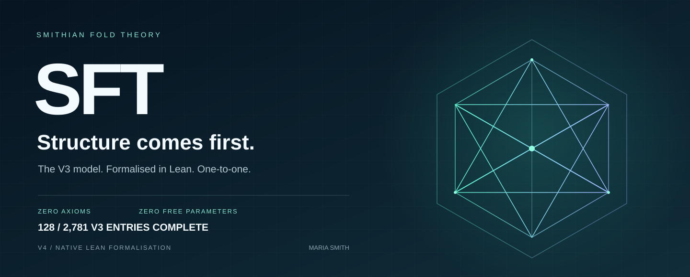

## 267 / 2,781 V3 entries complete

**12,785 Lean theorems proved · 0 axiom dependencies · Matter through exchange, conserved labels, particle spectrum, hadrons, scattering and decay verified.**

<p align="center">
  
</p>

<p align="center">
  <a href="#the-model">The model</a> ·
  <a href="#proof-status">Proof status</a> ·
  <a href="ZENODO_PAPER_DRAFT.txt">Read the paper</a> ·
  <a href="#run-the-proofs">Run the proofs</a> ·
  <a href="TIMELINE.txt">Timeline</a>
</p>

<p align="center">
  
  
  
  
</p>

## SFT preprint - publication edition 0.1

**Smithian Fold Theory: A Zero-Axiom, Zero-Free-Parameter Derivation of the Fine-Structure Constant — Lean 4 Formal Verification**

Alpha opens the cumulative SFT theory-of-everything manuscript. The full paper grows with the formalisation of all 2,781 V3 entries.

**[Read the paper](publication/SFT_PAPER.pdf)** · [Zenodo DOI](https://doi.org/10.5281/zenodo.23782217) · [Full text](ZENODO_PAPER_DRAFT.txt) · [Contents](publication/CONTENTS.txt) · [Release index](publication/RELEASE_INDEX.json)

Publication edition 0.1 includes linked contents, numbered sections, the full timeline, source snapshot and verification evidence. Further editions require the author's approval at the publication milestones.

# One model. Every derivation. Machine-checked.

**SFT v4 is the native Lean formalisation of Maria Smith’s Smithian Fold Theory v3.** The task is exact: carry the existing model into Lean, preserving its definitions, constraints, dependency order and derivations across all **2,781 registered entries**.

The governing requirement is **1:1 correspondence with v3**. Each scientific declaration is tied to its source. Each completed proof is audited for axiom dependencies. The entire model is the verification target.

## The model

SFT presents a structural unified theory of everything: gravity, particles and physical constants derived from first principles, with zero added axioms and zero free scientific parameters. This repository is the formal verification programme for that existing model.

Its foundation begins with an operational distinction: absence presents no counterexample; a presented challenge supplies an occurrence. The source then develops structural One and exact positive finite count, followed by Part, Fold and the downstream model.


## Proof status

Entry completion means the entry’s actual pinned V3 content is formalised and its applicable checks pass. Entries are completed in registered dependency order. Missing work must identify a specific V3 source component; general host-library or unrelated platform tasks do not hold a scientific entry open.

**12,785 proofs completed · 90,982 candidate records matched · 267 model entries complete · Matter through exchange, conserved labels, particle spectrum, hadrons, scattering and decay verified.**

| Progress measure | Current result |
| :--- | :--- |
| Lean theorems proved | **12,785**, all with zero axiom dependencies |
| Definitions and theorems audited | **30,284**, all with zero axiom dependencies |
| Candidate records matched to v3 | **90,982 / 90,982** across 249 completed source entries |
| Complete model entries | **267 / 2,781** — [latest completion evidence](verification/TURN_494_DECAY_COMPLETION.json) |

| Source component | Verified work | Evidence |
| :--- | :--- | :--- |
| **Initial mechanics — complete** | Events, duration, reference-relative displacement and oriented velocity; all original derivations, grammars and blind empirical outputs | [Completion evidence](verification/TURN_482_VELOCITY_COMPLETION.json) · [Mathematical exposition](ZENODO_PAPER_DRAFT.txt) |
| **Measurement closure — complete** | Nine entries from observation through dimensional consistency; exact derivations, all original grammars and full blind empirical comparisons | [Latest completion](verification/TURN_481_CONSISTENCY_COMPLETION.json) · [Mathematical exposition](ZENODO_PAPER_DRAFT.txt) |
| **Root — complete** | All pinned Root source functions and program methods mapped; general record derivation, exact enumeration, closure and controls verified | [Completion evidence](verification/TURN_111_ROOT_COMPLETION.json) · [Fresh output checks](verification/TURN_111_ROOT_EVIDENCE_REPORT.json) |
| **One — complete** | General record derivation, full grammar, closure, controls and all program methods | [Completion evidence](verification/TURN_112_ONE_COMPLETION.json) |
| **Count — complete** | General finite-trace derivation, full grammar, closure, controls and all program methods | [Completion evidence](verification/TURN_112_COUNT_COMPLETION.json) |
| **Part — complete** | General held/whole coordinate derivation, full192 grammar, original closure/controls and all program methods | [Completion evidence](verification/TURN_113_PART_COMPLETION.json) |
| **Part Equivalence — complete** | General common-refinement/pairing derivations, full1024 grammar, original controls and complete source program | [Completion evidence](verification/TURN_116_PART_EQUIVALENCE_COMPLETION.json) |
| **Fold — complete** | Minimal-stage derivation, full288 grammar, original closure/controls and all source program methods | [Completion evidence](verification/TURN_114_FOLD_COMPLETION.json) |
| **Fold assembly — complete** | General support, transition, return and proposal proofs; full192 program matches V3 | [Completion evidence](verification/TURN_115_ASSEMBLY_COMPLETION.json) |
| **Exact operations** | Canonical Fraction reduction, exact value preservation, positive-domain guards, normalized cast/Fold/Take, exact unison and Fold-fixed One; complete 128-form grammar and source controls | [Operations](SFT/Foundation/ExactOperations.lean) · [Reduction proofs](SFT/Foundation/FractionReduction.lean) |
| **Half-One** | Complete first-Fold selection classes, label-exchange invariance, unique self-junction coordinate, self-complementarity and Fold-to-One; all 128 source candidates and four controls | [Derivation](SFT/Foundation/HalfOneDerivation.lean) |
| **Fold dynamics** | Exactly two preimages for every admitted image, with arbitrary-preimage exhaustion; full-domain phase laws, exact sorted output and executable uniformity for every even division and minimal two-cycle | [Derivation](SFT/Foundation/FoldDynamics.lean) |
| **Form Grammar — complete** | Complete 288-candidate enumeration, unique survivor, nine rejection rules and original controls | [Grammar](SFT/Foundation/FormGrammar.lean) |
| **Exact trace arithmetic** | General flattened-product associativity, complete pair-cell cardinality, exact pairing and held remainder | [Derivation](SFT/Mathematics/ExactTraceArithmetic.lean) |
| **Measured-value boundary** | Exact Boolean protocol conditions, complete 256-candidate product and original controls | [Derivation](SFT/Foundation/MeasurementProtocol.lean) |
| **Form identity — complete** | Canonical trace injectivity and equivalence for every generated Form; complete 192-candidate identity grammar | [Derivation](SFT/Foundation/FormIdentity.lean) |
| **Form construction** | Exact finite productions, injective tuple encoding and acceptance of every generated form by the tuple/list/string validator | [Derivation](SFT/Foundation/FormConstruction.lean) |
| **Source correspondence** | The retained 47,206-record checkpoint preserves source order, identifiers, exact forms, decisions and reasons; Root census, closure, decisions and all four control records match stored fields and hashes | [Correspondence map](reference/CORRESPONDENCE.json) · [Parity report](verification/TURN_279_PARITY_REPORT.json) |

**Completed source entries: 267 / 2,781.** 1 entry is in progress and 2,513 remain pending. Exact source-component evidence is recorded in COVERAGE.json. Acceleration, inertia, momentum and force are complete in source dependency order. Their native derivations, full source-program comparisons and complete empirical checks are included in the registered totals.

[Read the current axiom audit →](verification/TURN_494_REGISTERED_DECLARATIONS_AUDIT.log) · [Inspect complete coverage →](COVERAGE.json) · [Root evidence/hash checks →](verification/TURN_013_EVIDENCE_REPORT.json) · [All 30,284 axiom audits →](verification/TURN_494_REGISTERED_DECLARATIONS_AUDIT.log)

The translated forcing gate checks ordered identifiers, exactly one survivor, explicit reasons and canonical proof-hash identities. A general theorem proves that passing requires one survivor; Root’s tampered decisions are formally rejected. [Gate proofs](SFT/Engine/DecisionGate.lean) · [Root integration](SFT/Foundation/RootGate.lean) · [384-case comparison](verification/TURN_009_DECISION_GATE_REPORT.json)

The closure and control gates now retain their source field checks and error order. Native proofs establish required passing properties and reject Root evidence with missing minimality, missing generality certification or failed control flags. [Evidence-gate proofs](SFT/Engine/EvidenceGates.lean) · [432 closure and 576 control cases](verification/TURN_010_EVIDENCE_GATES_REPORT.json)

The census gate preserves signed cardinalities, candidate identity checks and source error order. Native proofs establish positive-cardinality witnesses and reject Root censuses with incorrect counts or duplicate candidates. [Census gate](SFT/Engine/CensusGate.lean) · [1,440-case comparison](verification/TURN_011_CENSUS_GATE_REPORT.json)

The Root record-level derivation now quantifies over all records with the source fields. It proves exact presentation classification, agreement of classification and acceptance, exclusion of unpresented records, and independence from identifier and descriptive text. Generated records connect directly to the emitted evidence. [Root derivation proofs](SFT/Foundation/RootDerivation.lean)

One’s record-level derivation proves that complete coverage without addition is necessary and sufficient for acceptance. Omission, fragmentation and unforced addition are rejected for every source-schema record. [One derivation proofs](SFT/Foundation/OneDerivation.lean)

Count’s finite-generation proof now establishes complete exact-once retention at every extension, freshness of the new terminal, rejection of repetition and deletion, and unique identity under the source base/successor clauses. [Count trace derivation](SFT/Foundation/CountTrace.lean)

Count’s proposal theorem derives the ten-class decision from actual retained positions: acceptance is equivalent to complete coverage, no duplication and no ungenerated occurrence. [Semantic bridge](SFT/Foundation/CountRepresentation.lean) · [493-proposal correspondence](verification/TURN_016_COUNT_REPRESENTATION_REPORT.json)

## Exact correspondence, from the root

| Commitment | How it is recorded |
| :--- | :--- |
| **Preserve the model** | Scientific declarations map to identified v3 source components. |
| **Preserve the constraints** | No added axioms, unfinished proofs or free scientific parameters. Audits report actual dependencies. |
| **Follow dependencies** | Complete the source foundation in order before advancing into dependent claims. |
| **Keep the evidence visible** | Proof logs, source comparisons and granular coverage accompany checkpoints. |
| **Keep a complete record** | The chronological timeline records work; the manuscript presents the science. |

The source is pinned to v3 commit [`76f1b34`](https://github.com/MettaMazza/ernos-labs-sft-platform/tree/76f1b34e9e9682989adcbb088797b4ae4ce4fcf1). The [source inventory](reference/V3_TRACKED_FILES.tsv) records 39,278 tracked paths.

## Run the proofs

With Lean’s `elan` toolchain manager installed:

```sh
git clone https://github.com/MettaMazza/SFT-v4-LEAN-VERIFIED.git
cd SFT-v4-LEAN-VERIFIED
lake build
lake env lean Audit.lean
```

The project pins Lean **4.35.0**. Emit the translated records with:

```sh
lake env lean --run Parity.lean
lake env lean --run RootParity.lean
```

Every verification run rebuilds current Lean code, generates a fresh declaration audit and executes the current parity program. Committed TSVs and logs are historical evidence, never the verification input.

```sh
SFT_V3_SOURCE=/path/to/pinned/v3 python3 verification/check_current_parity.py
SFT_V3_SOURCE=/path/to/pinned/v3 python3 verification/check_root_evidence.py
SFT_V3_SOURCE=/path/to/pinned/v3 python3 verification/check_decision_gate.py
SFT_V3_SOURCE=/path/to/pinned/v3 python3 verification/check_evidence_gates.py
SFT_V3_SOURCE=/path/to/pinned/v3 python3 verification/check_census_gate.py
SFT_V3_SOURCE=/path/to/pinned/v3 python3 verification/check_registration_gate.py
SFT_V3_SOURCE=/path/to/pinned/v3 python3 verification/check_count_representation.py
```

The scripts read pinned v3 source and artifacts without importing or executing v3 scientific modules. `SFT_V3_SOURCE` overrides the local path in `reference/SOURCE.json`. [GitHub Actions](.github/workflows/verify.yml) performs these checks on pushes and pull requests using the pinned source commit and Lean toolchain.

## Explore the work

| | |
| :--- | :--- |
| **[Scientific manuscript](ZENODO_PAPER_DRAFT.txt)** | The accompanying Zenodo paper draft. Unpublished. |
| **[Chronological timeline](TIMELINE.txt)** | Exact steps, checks, outcomes and continuation points. |
| **[Full coverage ledger](COVERAGE.json)** | Every registered entry, original statement and tracked status. |
| **[Proof audit](Audit.lean)** | The exported results and their Lean axiom checks. |
| **[Original SFT v3](https://github.com/MettaMazza/ernos-labs-sft-platform)** | The source model being formalised. |

---

<p align="center"><strong>Smithian Fold Theory · Maria Smith</strong><br/><sub>V3 is the source. Lean is the proof language. Exact correspondence is the requirement.</sub></p>

Batch review: [all 21 existing entries](verification/TURN_114_BATCH_EXISTING_WORK.json). Run `python3 verification/batch_existing_work.py` for the existing global build/audit/parity and exact missing-method inventory. Interface presence alone does not establish derivation completion.

Full-program comparisons are retained in the [batch source review](verification/TURN_115_SOURCE_REVIEW.json) and subsequent entry-specific completion checkpoints. Current registered comparisons cover **90,982 candidate records across 267 source entries**, including registration, census, closure, controls and hashes. The [mechanics batch](verification/TURN_483_MECHANICS_BATCH/STATUS.json) is now included in the registered totals. `verification/batch_program_outputs.py` reproduces its configured driver list; later completion checkpoints retain their additional source-specific drivers and reports.

Part Equivalence checkpoint: all **1,024** fresh native lookup decisions and complete source program outputs match pinned V3. [Program comparison](verification/TURN_116_PART_EQUIVALENCE_PROGRAM_REPORT.json).

Batch completion reconciliation: all **21** represented entries reviewed together, with **6** additional completions propagated through verified dependencies. Existing program results and the current full audit are retained. [Batch reconciliation](verification/TURN_118_BATCH_RECONCILIATION.json).

Final existing-work batch: **6 / 6 programs PASS**, **980 actual candidate decisions**, all original evidence fields and hashes matched. Measurement retains returned operands; Exact Operations and Half-One include their complete source program adapters. [Six-entry completion report](verification/TURN_119_BATCH_COMPLETION.json).

Geometry and Topology: four original operations translated with20 new native proofs, including incidence, shared-face adjacency, exact open-family closure, inverse-image continuity and finite generated joins/intersections. Boundary depth is now translated with a complete descent derivation proved equivalent to execution; path search is translated with returned-path soundness; general shortest-path minimality and unreachable-case equivalence are proved; the full1024-candidate source program now matches every pinned source output field. [Source-specific progress](verification/TURN_120_GEOMETRY_PROGRESS.json).

Boundary dimension: 15 additional native proofs, exact cycle rejection and both directions of complete face-depth derivation. [Verified source-specific results](verification/TURN_121_GEOMETRY_PROGRESS.json).

Path distance: exact ordered undirected search, constructive returned-path traces and literal edge-scan correspondence;19 additional native proofs. [Source-specific results](verification/TURN_122_GEOMETRY_PROGRESS.json).

General path results: returned paths have minimal length against every finite undirected trace; unreachable None is equivalent to absence of such a trace.20 additional axiom-free proofs. [Source-specific results](verification/TURN_123_GEOMETRY_PROGRESS.json).

Geometry and Topology is complete against its pinned V3 source: all six operations, native derivations, full1024 candidates, original witnesses/controls and program methods.  [Completion evidence](verification/TURN_124_GEOMETRY_COMPLETION.json).

Probability and Statistics: exact events, positive held/whole weights and common-refinement conditioning translated with25 new native proofs. [Source-specific progress](verification/TURN_125_PROBABILITY_PROGRESS.json).

Probability independence and exact modal summaries:31 additional native proofs,3185 independence cases and121 mode cases passed. [Source-specific progress](verification/TURN_126_PROBABILITY_PROGRESS.json).

Probability and Statistics is complete against pinned V3: six original operations, general native derivations, all512 candidates, exact witnesses/controls and every program output. [Completion evidence](verification/TURN_127_PROBABILITY_COMPLETION.json).

Optimization is complete against pinned V3: six operations, general native derivations, full512-candidate grammar, original witnesses/controls and exact program outputs. [Completion evidence](verification/TURN_128_OPTIMIZATION_COMPLETION.json).

Dynamical Systems: exact admission, trajectories, transition-count time, fixed forms, predecessor records and retained-record reversibility with15 new native proofs. [Source-specific progress](verification/TURN_129_DYNAMICS_PROGRESS.json).

Dynamical Systems is complete against pinned V3: eight operations, general trajectory/return/reachability derivations, all1024 candidates, seven witnesses and every source program output. [Completion evidence](verification/TURN_130_DYNAMICS_COMPLETION.json).

Logic and Proof is complete against pinned V3: original validated constructors, six operations, ordered proof-trace equivalence and relative soundness, full1024 grammar and exact program output. [Completion evidence](verification/TURN_131_LOGIC_COMPLETION.json).

Category, Type and Composition: native composition-trace association, exact validated arrow fields, type predicates, products and held sums are implemented. Twenty additional theorems and2,053 operational cases pass; identity erasure, transport/naturality and the original full grammar/program are now completed in the subsequent source review.

Category, Type and Composition is complete against pinned V3. [Source-component completion evidence](verification/TURN_133_CATEGORY_COMPLETION.json).

Symbol Distinction: original alphabet admission, complete observation validation, exact single-row lookup and distinguishability are implemented, with17 native proofs and2,016 passing input cases. Observation classes, pair ledgers and the512 grammar/program are completed in the subsequent source review.

Symbol Distinction is complete against pinned V3. [Source-component completion evidence](verification/TURN_135_SYMBOL_COMPLETION.json).

Encoding and Decoding: source validation, codeword classes, exact inverse construction and decoder lookup are implemented.21 native proofs include singleton-class equivalence and decoder left inverse;9,684 input cases pass. Loss ledger, composition, successor closure and complete1024 grammar/program are verified.

Encoding loss and composition add23 native proofs and7,553 passing input cases, including exact shared-class loss, guarded interface existence and complete composition provenance.

Encoding and Decoding is complete against pinned V3. [Source-component completion evidence](verification/TURN_138_ENCODING_COMPLETION.json).

Information Quantity: exact complete word support, ordered position successor and support composition with21 new native proofs and1,769 passing input cases. Pair/profile/position-trace execution and complete512 grammar/program are verified.

Information Quantity is complete against pinned V3. [Source-component completion evidence](verification/TURN_279_MIXING_COMPLETION.json).

Entropy and Uncertainty: exact partition, structural empty-One uncertainty, class-ordered closed pairs and refinement/class-containment equivalence with22 new native proofs and7,781 passing input cases. Exact weighted ledger and pair monotonicity are verified; microstate successor and the complete512 program are verified.

Entropy exact weighted ledger and closed-pair monotonicity add23 native proofs and2,024 passing Fraction-based input cases.

Compression reconstruction and complete dictionary/token resource traces are verified, including general token-successor and redundancy provenance proofs;8,600 source-expression cases pass. Exact prefix parsing, the canonical-support pigeonhole derivation and complete1024 program are verified.

Channel admission, exact output supports, confusability and distinguishable-code predicates have native proofs and12,913 passing source-expression cases. Capacity enumeration and relational composition are verified; fresh-input successor and complete1024 program are verified.

Channel complete capacity families and exact relational composition add6,857 passing comparisons. Native proofs retain every greatest tie and every source-to-interface-to-target path, with source first-occurrence ordering and no restored merged distinction.

Synchronization is complete: source-bound readiness and release, complete blocked-row ledger, retained serial and parallel composition, source-successor proofs, full256 grammar, witnesses, controls and every original program field/hash pass with zero axioms.

Communication: exact source-bound delivery provenance, complete event/channel product, message retention, trace composition and retained/lost distinction proofs pass with zero axioms. All 4,266 concrete kernel output checks and fresh 256-candidate parity pass. Full program field/hash comparison passes; Communication is complete.

Distributed Partial Order and Consensus: native carrier,closure,trace,composition and successor results pass the zero-axiom audit. Batch checks cover all512 three-event relations and600 terminal decision cases. Both original full-program comparisons passed; both entries are complete.

Agreement Impossibility: native contradiction for equal local observations with different required decisions,exact scheduler support,complete witness enumeration and retained successor proofs pass with zero axioms;1,024 kernel cases pass. Full-program comparison runs alongside the earlier batch.

DistributedOrder, Consensus complete: original full-program comparisons PASS; dependency-ordered completed count 267 / 2,781.

Replication/Consistency: native source-bound update traces,identity preservation,complete state classes,composition,successor and retained order-loss proofs pass with zero axioms.726 kernel outputs and two concrete replay orders pass. Full-program comparison runs concurrently with Agreement Impossibility.

Fault Model: source-bound detection/recovery/uncorrectable classification,exact generated-support guarantee and retained recovery/composition proofs pass with zero axioms.3,328 kernel outputs pass; original full-program comparison runs concurrently.

AgreementImpossibility complete: original full-program comparisons PASS; 114 completed entries.

Distributed Knowledge: exact local observation classes and finite common-knowledge closure proofs pass with zero axioms. 388 concrete checks pass; the full-program comparison is running.

Replication complete: original full-program comparisons PASS; 115 completed entries.

Locality: exact registered neighborhood/trace equivalence, local input views and indistinguishability lower witness pass with zero axioms. 834 kernel checks pass; full-program comparison runs concurrently.

FaultModel complete: original full-program comparisons PASS; 116 completed entries.

Network Computation: registered local-machine transitions, messages, schedules, aggregate outputs and resource/fault provenance pass with zero axioms. A concrete two-process execution and eight output/boundary checks pass; full-program comparison runs concurrently.

DistributedKnowledge complete: original full-program comparisons PASS; 117 completed entries.

One-Wayness: exact inverse fibres, admitted adversary traces, complete bounded-success ledger and source security partition pass with zero axioms. 1,305 kernel checks pass; full-program comparison runs concurrently.

Locality complete: original full-program comparisons PASS; 118 completed entries.

Secrecy: exact possible-message provenance, complete closed-distinction ledger, no-observation-recovery and disclosure boundary proofs pass with zero axioms. 1,729 checks pass; full-program comparison runs concurrently.

NetworkComputation complete: original full-program comparisons PASS; 119 completed entries.

Integrity: complete accepted/rejected/false-accept ledgers, computed authorization guarantee and retained serial traces pass with zero axioms. 1,026 checks pass; full-program comparison runs concurrently.

OneWayness complete: original full-program comparisons PASS; 120 completed entries.

Authentication: exact credential/challenge/response verification traces, complete impersonation ledger and computed authenticity boundary pass with zero axioms. 4,100 checks pass; full-program comparison runs concurrently.

Secrecy complete: original full-program comparisons PASS; 121 completed entries.

Hashing: exact preimage/collision ledgers, constructive larger-domain collision witness, composition and domain separation pass with zero axioms. 36 concrete outputs and eight collision-witness instantiations pass; full-program comparison runs concurrently.

Integrity complete: original full-program comparisons PASS; 122 completed entries.

Commitment: complete binding-collision and hiding ledgers, exact compatibility boundary and retained commit/opening phase traces pass with zero axioms. 2,313 checks pass; full-program comparison runs concurrently.

Authentication complete: original full-program comparisons PASS; 123 completed entries.

Signature: exact signing/verification,computed correctness,complete forgery ledger and retained traces pass with zero axioms. 2,048 concrete checks pass; full-program comparison runs concurrently.

Hashing complete: original full-program comparisons PASS; 124 completed entries.

Proof of Knowledge: constructive extraction,computed registered-adversary knowledge,exact failure ledger and retained process traces pass with zero axioms. 1,024 checks pass; full-program comparison runs concurrently.

Zero Knowledge: exact observation/simulation correspondence,computed coverage and acceptance,complete disjoint/exhaustive distinction ledgers and actual simulator traces passzeroaxioms. 3,584 checks pass; full-program comparison runs concurrently.

Commitment complete: original full-program comparisons PASS; 125 completed entries.

Multiparty Computation: exact input/view projections,complete leakage ledger,computed coalition privacy,registered security and actual communication traces passzeroaxioms. 768 concrete checks pass; full-program comparison runs concurrently.

Signature complete: original full-program comparisons PASS; 126 completed entries.

Adversarial Computation: exact admission/resource boundaries,complete disjoint/exhaustive outcome ledgers,computed security and actual stopped traces passzeroaxioms. 2,048 checks pass; full-program comparison runs concurrently.

ProofKnowledge complete: original full-program comparisons PASS; 127 completed entries.

Security Definition: exact success/resource ledgers,distinct observation-closure and bounded-failure derivations,source-preserving reductions and composition passzeroaxioms. 1,024 checks pass; full-program comparison runs concurrently.

ZeroKnowledge complete: original full-program comparisons PASS; 128 completed entries.

Post-Quantum Boundary: declared interfaces,exact query/resource ledgers,classical operational exclusions,certified reductions and migration passzeroaxioms. 770 checks pass; full-program comparison runs concurrently.

Multiparty complete: original full-program comparisons PASS; 129 completed entries.

Inference: exact source executable,complete retained/eliminated and uncertainty ledgers,proof traces and evidence monotonicity passzeroaxioms. 194 checks pass; full-program comparison runs concurrently.

Adversarial complete: original full-program comparisons PASS; 130 completed entries.

Classification and Prediction: sealed source predictions,target custody,exact matching/falsification ledgers and preserved prediction interfaces passzeroaxioms. 1,536 checks pass; full-program comparison runs concurrently.

SecurityDefinition complete: original full-program comparisons PASS; 131 completed entries.

Representation Learning: exact transformation/task traces,complexity and distinction ledgers,composition provenance and source extension passzeroaxioms. 518 checks pass; full-program comparison runs concurrently.

PostQuantumBoundary complete: original full-program comparisons PASS; 132 completed entries.

Generalization: complete withheld targets,exact pass/failure ledgers,target custody and exhaustive structural-family certificates passzeroaxioms. 64 checks pass; full-program comparison runs concurrently.

Inference complete: original full-program comparisons PASS; 133 completed entries.

Sample Complexity: exact teaching certificates,complete ambiguity closure and constructive distinguishing evidence pass zero axioms. 1,024 checks pass; original full-program comparison runs concurrently.

ClassificationPrediction complete: original full-program comparisons PASS; 134 completed entries.

Optimization in learning: exact evidence-compatible selection,complete elimination witnesses,retained ties and replayable update traces pass zero axioms. 512 concrete outputs pass; original full-program comparison runs concurrently.

RepresentationLearning complete: original full-program comparisons PASS; 135 completed entries.

Computational induction: exact alternatives,minimality,successor tests,falsification and structurally certified continuation pass zero axioms. 1,026 concrete outputs pass; original full-program comparison runs concurrently.

Generalization complete: original full-program comparisons PASS; 136 completed entries.

Search and Planning: exact goal-reaching plans,complete execution/failure/resource ledgers and serial composition pass zero axioms. 1,536 concrete outputs pass; original full-program comparison runs concurrently.

SampleComplexity complete: original full-program comparisons PASS; 137 completed entries.

Reinforcement Computation: exact policy-bound trajectories,outcome labels,complete evaluation ledgers and serial composition pass zero axioms. 1,024 concrete outputs pass; original full-program comparison runs concurrently.

LearningOptimization complete: original full-program comparisons PASS; 138 completed entries.

Multi-Agent Computation: exact joint rows,local observations,communication traces and cycle ledger pass zero axioms. 2,208 concrete outputs pass; original full-program comparison runs concurrently.

ComputationalInduction complete: original full-program comparisons PASS; 139 completed entries.

Adaptation: exact update traces,identity-preserving receipts,performance relation and failure boundary pass zero axioms. 640 concrete outputs pass; original full-program comparison runs concurrently.

SearchPlanning complete: original full-program comparisons PASS; 140 completed entries.

Learning Limits: exact indistinguishable evidence,same learner decision and source-bound constructive counterexamples pass zero axioms. 64 concrete outputs pass; original full-program comparison runs concurrently.

Reinforcement complete: original full-program comparisons PASS; 141 completed entries.

Interpretability and Verification: exact decision certificates,complete traces,premise ledgers and actual tamper rejection pass zero axioms. 1,536 concrete outputs pass; original full-program comparison runs concurrently.

MultiAgent complete: original full-program comparisons PASS; 142 completed entries.

Classical Learning: actual inference,sealed evaluation,complete prediction/resource ledgers and reproducible reports pass zero axioms. 64 concrete outputs pass; original full-program comparison runs concurrently.

Adaptation complete: original full-program comparisons PASS; 143 completed entries.

LearningLimits complete: original full-program comparisons PASS; 144 completed entries.

Interpretability complete: original full-program comparisons PASS; 145 completed entries.

ClassicalLearning complete: original full-program comparisons PASS; 146 completed entries.

Capability complete: original full-program comparisons PASS; 147 completed entries.

ExactApproximate complete: original full-program comparisons PASS; 148 completed entries.

Stability complete: original full-program comparisons PASS; 149 completed entries.

ErrorPropagation complete: original full-program comparisons PASS; 150 completed entries.

Discretization complete: original full-program comparisons PASS; 151 completed entries.

Convergence complete: original full-program comparisons PASS; 152 completed entries.

ScientificSymbolic complete: original full-program comparisons PASS; 153 completed entries.

Simulation complete: original full-program comparisons PASS; 154 completed entries.

ComputationalDynamics complete: original full-program comparisons PASS; 155 completed entries.

InverseProblem complete: original full-program comparisons PASS; 156 completed entries.

ComputationalStatistics complete: original full-program comparisons PASS; 157 completed entries.

HighDimensional complete: original full-program comparisons PASS; 158 completed entries.

ManyBody complete: original full-program comparisons PASS; 159 completed entries.

MathematicalModelling complete: original full-program comparisons PASS; 160 completed entries.
