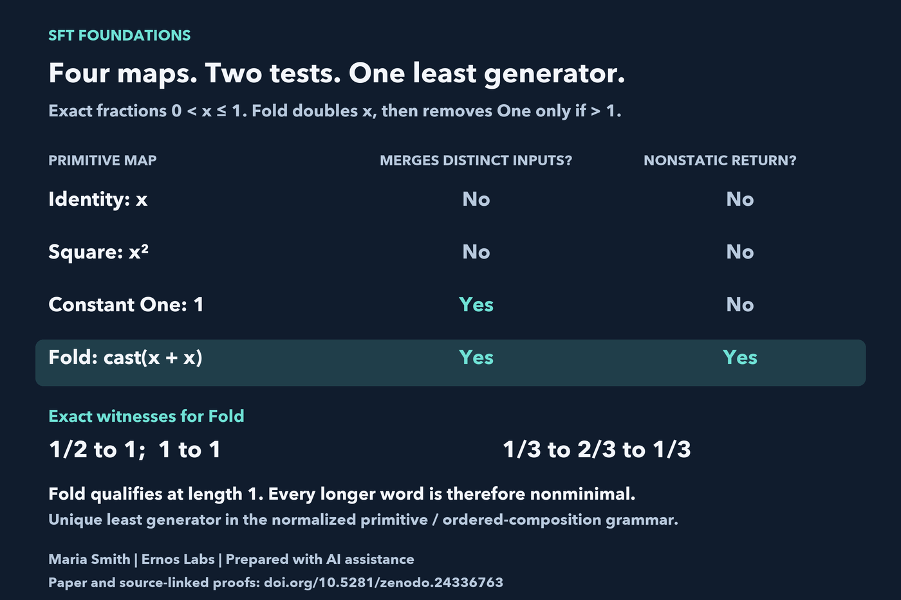
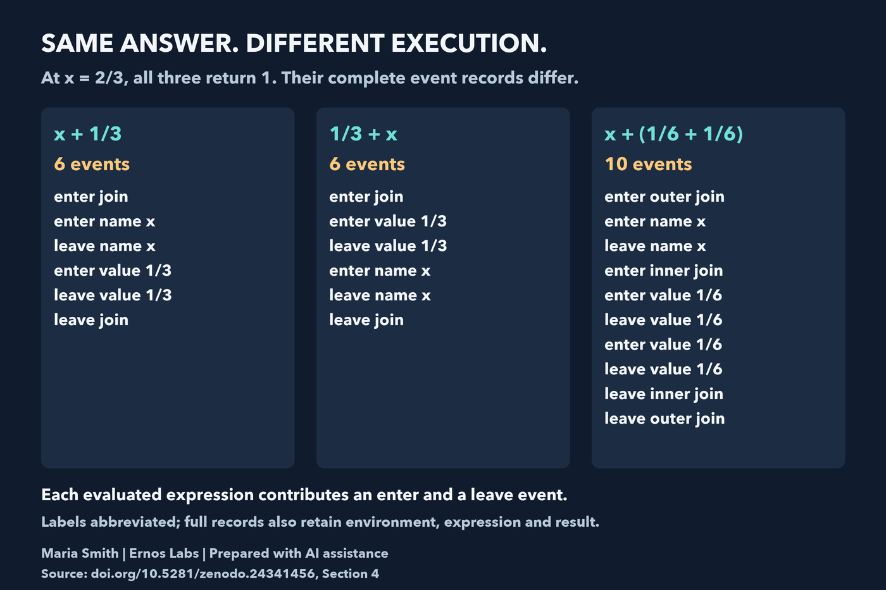
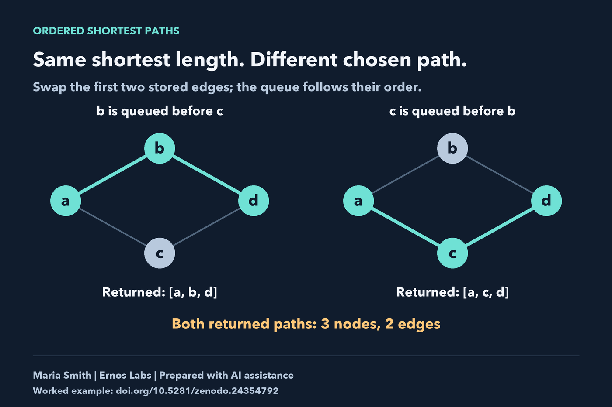
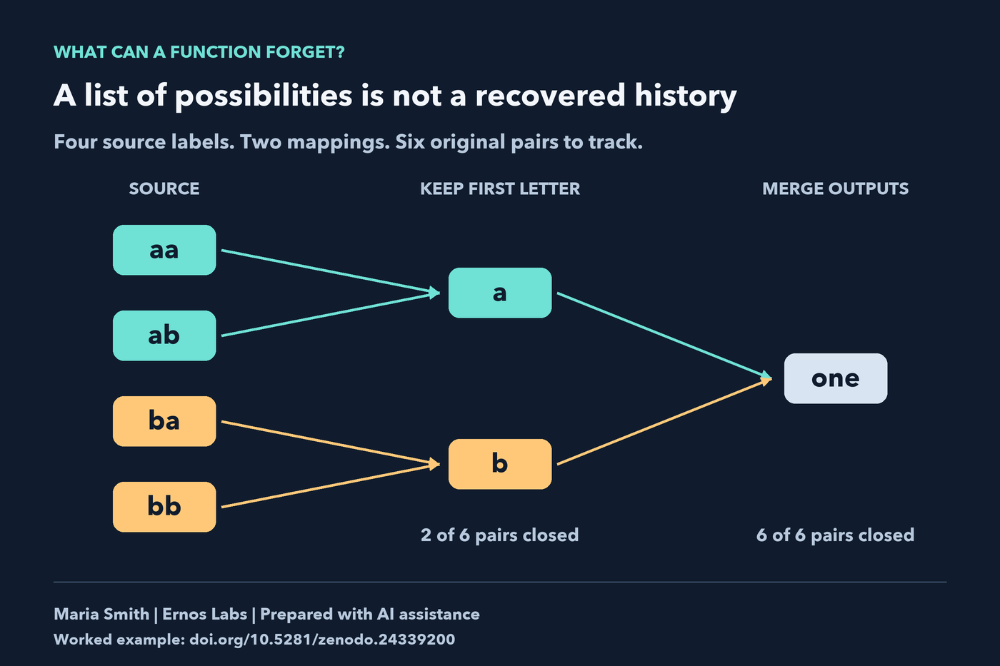
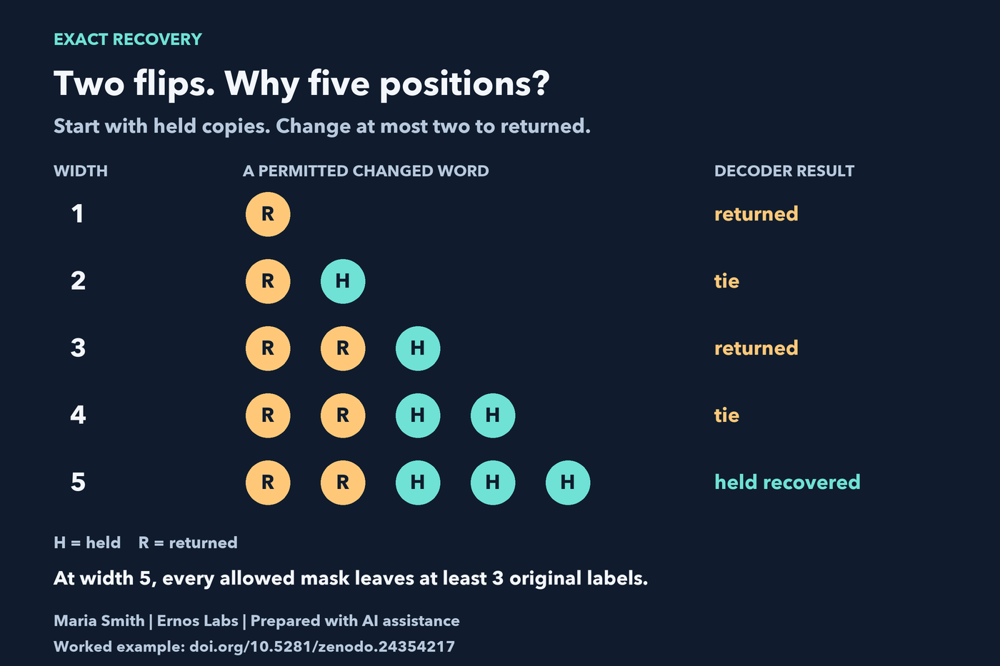
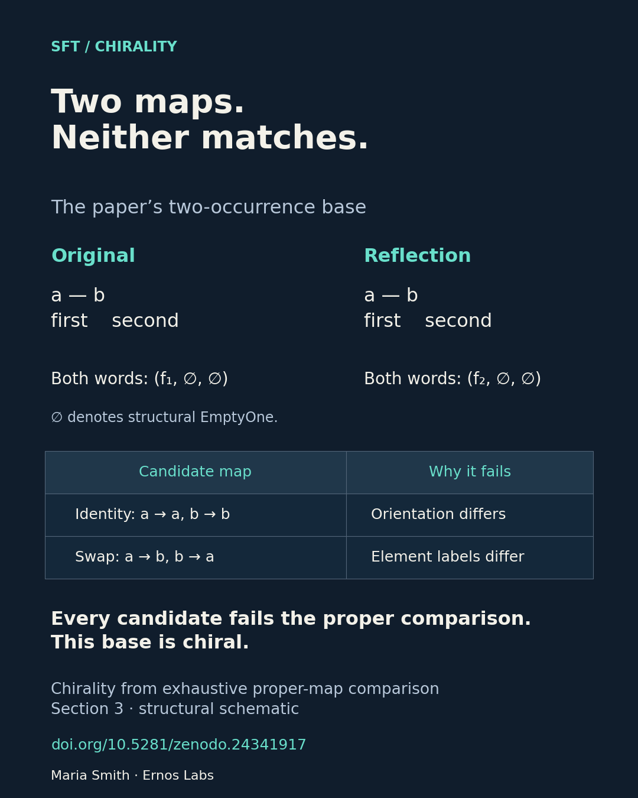
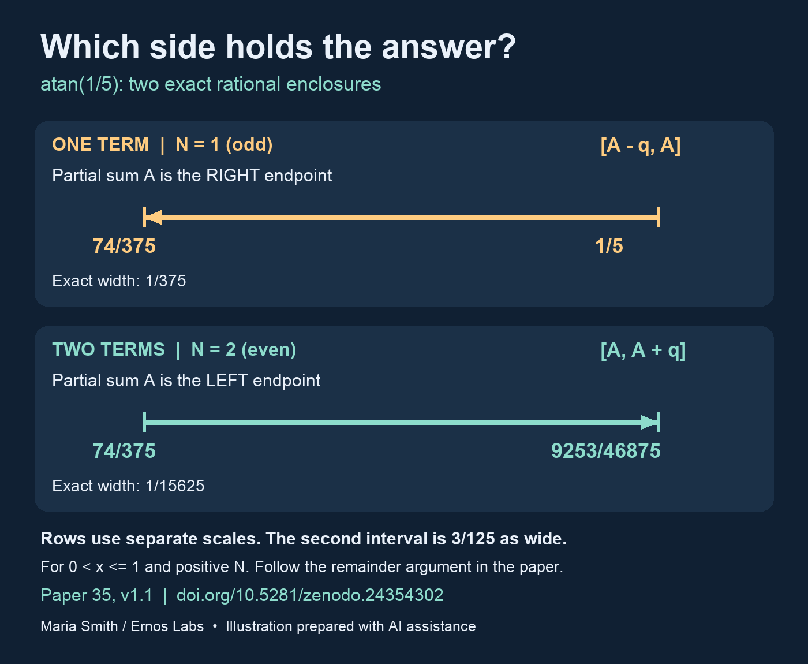

# SFT: choose a worked example

Seven illustrated entry points into Maria Smith’s published papers. Start with a question, inspect the diagram, then follow the paper or focused guide to the construction and proofs.

Scientific author: **Maria Smith, Ernos Labs**. These educational illustrations were prepared with AI assistance under her direction. Preserve the author credit, paper DOI and source context when sharing. The diagrams introduce examples; their linked papers and proof references contain the general arguments.

[Complete reading guide and published editions](../START_HERE.txt) · [How to reproduce a selected edition](../REPRODUCTION_GUIDE.txt) · [Optional focused review form](../FOCUSED_REVIEW_FORM.txt)

## Four maps, two tests

Which maps merge distinct inputs, and which have a nonstatic return?

[Full-size PNG](foundation-fold-card.png) · [Detailed accessible description](foundation-fold-card-alt.txt) · [Paper](https://doi.org/10.5281/zenodo.24336763)

## Same answer, different execution

Compare the result, evaluation order and event count of three expressions.

[Full-size PNG](compiler-execution-card.png) · [Detailed accessible description](compiler-execution-card-alt.txt) · [Paper](https://doi.org/10.5281/zenodo.24341456) · [Focused reading guide](../COMPILER_REVIEW_BRIEF.txt)

## Which shortest route is returned?

Two equal-length routes show how stored edge order selects the returned witness.

[Full-size PNG](graph-route-card.png) · [Detailed accessible description](graph-route-card-alt.txt) · [Paper](https://doi.org/10.5281/zenodo.24354792) · [Focused reading guide](../GRAPH_REVIEW_BRIEF.txt)

## What does a map forget?

Follow six original pairs through a first-letter map and a constant map.

[Full-size PNG](information-mapping-card.png) · [Detailed accessible description](information-mapping-card-alt.txt) · [Paper](https://doi.org/10.5281/zenodo.24339200) · [Focused reading guide](../INFORMATION_LOSS_REVIEW_BRIEF.txt)

## Why two changes need five positions

Compare ties and wrong majorities at smaller widths with recovery at width five.

[Full-size PNG](circuit-recovery-card.png) · [Detailed accessible description](circuit-recovery-card-alt.txt) · [Paper](https://doi.org/10.5281/zenodo.24354217) · [Focused reading guide](../CIRCUIT_RECOVERY_REVIEW_BRIEF.txt)

## Two maps, neither matches

Exhaust the two candidate maps of the paper’s two-occurrence chirality base.

[Full-size PNG](chirality-two-maps.png) · [Detailed accessible description](chirality-two-maps-alt.txt) · [Paper](https://doi.org/10.5281/zenodo.24341917) · [Focused reading guide](../CHIRALITY_REVIEW_BRIEF.txt)

## Which side holds the answer?

Compare the one-term and two-term rational enclosures of atan(1/5). The rows use separate scales; the second interval is 3/125 as wide.

[Full-size PNG](calculator-parity-card.png) · [Detailed accessible description](calculator-parity-card-alt.txt) · [Paper, version 1.1](https://doi.org/10.5281/zenodo.24354302) · [Focused reading guide](../CALCULATOR_REVIEW_BRIEF.txt) · [Illustrated article](https://mariasmith732266.substack.com/p/how-to-check-a-numerical-bound-without) · [Runnable notebook](calculator-enclosure-example.ipynb)

## Try a longer exercise

- [Which shortest route is returned?](which-shortest-route.pdf) — printable diamond-graph exercise and worked answers, with [text version](which-shortest-route.txt).
- [What can a function forget?](what-can-a-function-forget.pdf) — printable worksheet with [text version](what-can-a-function-forget.txt) and [Spanish text](que-puede-olvidar-una-funcion.txt).
- [Can a ratio stop changing?](can-a-ratio-stop-changing.pdf) — substitution exercise with [text version](can-a-ratio-stop-changing.txt).
- [Compute bounds for pi](calculator-enclosure-example.py) — run `python3 calculator-enclosure-example.py --machin --terms 8`; [instructions and expected output](RUN_CALCULATOR_EXAMPLE.txt).
- [Exact calculator notebook](calculator-enclosure-example.ipynb) — editable rational examples, with [run instructions](RUN_CALCULATOR_EXAMPLE.txt).

Questions and independent examination are welcome. Identify the example, paper edition and exact step examined; include your reasoning or reproducible result. You can use the focused review form above or the [repository review discussion](https://github.com/MettaMazza/SFT-v4-LEAN-VERIFIED/issues/1).
